# Mono — Komari 单色主题

照着 [blog.rainside.top](https://blog.rainside.top) 的观感做的一套 Komari 探针主题：**Material 3
Expressive 单色版式**，纯黑底、填充式卡片、16px 圆角、零阴影零毛玻璃，顶部是整幅 banner +
居中大字 + 底部波浪过渡。

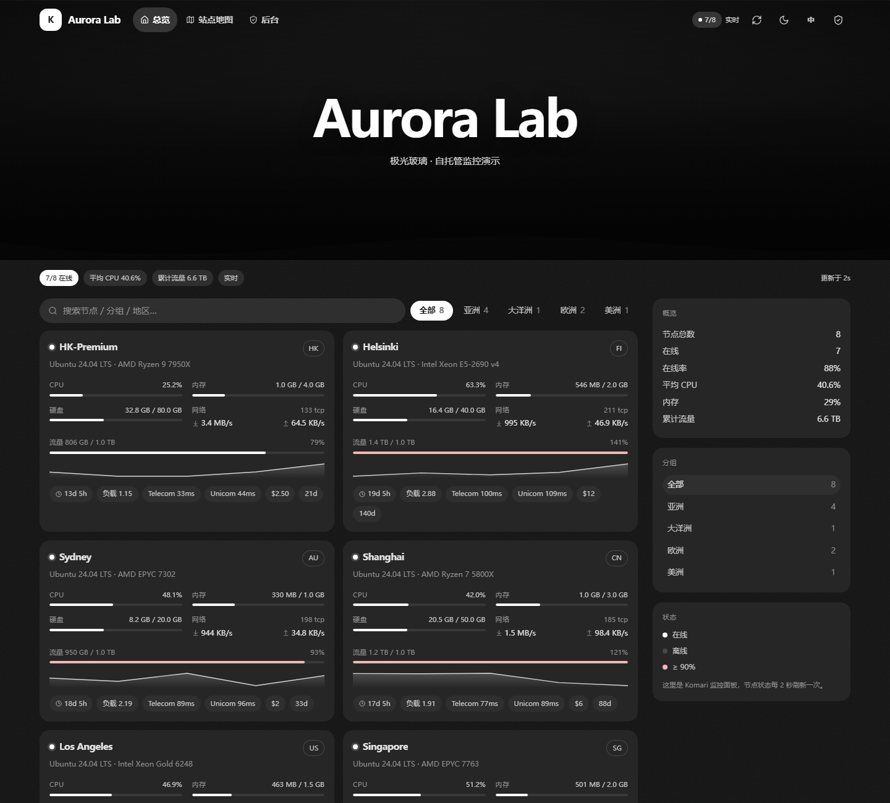

预览：[深色](docs/mono-dark.png) · [浅色](docs/mono-light.png) · [节点详情](docs/mono-drawer.png) · [移动端](docs/mono-mobile.png) ·
[带背景图（深）](docs/mono-bg-dark.png) · [带背景图（浅）](docs/mono-bg-light.png) ·
[衬线字体](docs/mono-font-serif.png) · [等宽字体](docs/mono-font-mono.png) ·
[站点地图](docs/mono-sitemap.png) · [世界地图](docs/mono-map.png)

## 从参考站点抄了什么

用 Chrome DevTools Protocol 在对方页面上取的计算样式，不是"看着像"：

| 项 | 参考站点 | 本主题 |
|---|---|---|
| 页面底色 | `--page-bg: #131313` | 同 |
| 卡片 | `#2a2a2a` 填充、`border-radius: 16px`、无阴影 | `#262626` / 16px / 无阴影 |
| 主色 | `--primary: #ffffff`，`--on-primary: #1b1b1b` | 同（`mono` 强调色） |
| 表面层级 | lowest `#0e0e0e` → highest `#353535` | 同五级 |
| 字体 | 自定义字体 + system-ui 兜底 | Inter → system-ui → 苹方/微软雅黑 |
| 纹理 | `--texture-opacity: 0.12` 噪点 | 同（可关） |
| 导航 | 14px 粗体、悬浮在 banner 上 | 同，滚动 96px 后转为实底 |
| 标题 | 80px/700 居中 | `clamp(38px, 7.2vw, 82px)` |

参考站是 Astro + m3e 组件库；这边是 React 19 + Vite 6 + Tailwind 4，只搬设计语言不搬代码。

## 版式

```
┌──────────────────────────────────────────────┐
│ 顶栏（banner 上透明 / 滚动后实底）             │
├──────────────────────────────────────────────┤
│  banner：站点名 + 描述，底部波浪切到页面底色    │
├──────────────────────────────────────────────┤
│  状态 chips：在线数 / 平均 CPU / 总流量 / 实时  │
├───────────────────────────┬──────────────────┤
│  搜索 + 分组筛选           │  概览            │
│  ┌─────────┬─────────┐    │  分组            │
│  │ 节点卡片 │ 节点卡片 │    │  状态说明        │
│  └─────────┴─────────┘    │                  │
└───────────────────────────┴──────────────────┘
```

## 功能
- **节点卡片**：CPU / 内存 / 硬盘白色进度条、实时上下行、流量配额（超 100% 转 M3 error 色）、
  延迟、负载、运行时长、到期天数、CPU 迷你曲线（最近 40 个快照，零额外请求）
- **详情侧边面板**：实时指标 + 1h/4h/24h 历史曲线 + 各探针延迟 min/avg/max + 系统信息
- **深链**：`#node=<uuid>`，刷新/分享直接打开对应节点；`#sitemap` 是独立的站点地图视图
- **站点地图**：按分组/地区切换、可搜索，每行一眼看完 CPU/内存/流量/在线时长，点行开详情
- **世界地图**：等距圆柱投影，节点按 `region`（ISO 码 / 国家名 / 城市名）落点到国家中心或城市
  坐标，同城节点自动聚合成一个带计数的点，悬停出节点列表、点击直接开详情
- **整页背景图**：填 URL 即固定铺满视口，可调遮罩浓度、模糊、cover/contain/平铺；
  有背景图时 hero 自动变透明让图透出来，卡片保持实色不糊
- **字体可换**：5 组预设字体栈（系统 / 无衬线 / 衬线 / 等宽 / 圆体）+ 自定义 `font-family`、
  基础字号 12–20px、数字等宽开关、可选外部字体 CSS（Google Fonts 或主题内 woff2）
- **深浅色 + 中英双语**，访客选择记在 `appearance` / `language`，与默认主题共用
- **站点图标可换**：填图片 URL 或用 1–2 个字的字母块，留空自动取站点名首字
- **29 项后台设置**：强调色（11 档色板 + 任意自定义色）、密度、颗粒、侧栏开关、各模块开关、置顶节点、延迟任务、历史范围、页脚、站点图标（图片/文字）、banner 图、背景图（通用/浅色/深色 + 遮罩/模糊/排布）、字体（字族/字号/等宽数字/字体 CSS）、地图开关
- **前台调色板（仅管理员）**：右上角调色板按钮 → 预设色块 + 系统取色器 + HEX 输入，保存即写入 Komari，全站生效
- **后台入口在右上角**：语言切换右边一个盾牌图标，隔一条细线，点进去就是 `/admin`；顶部导航只留总览和站点地图

## 开发

```bash
pnpm install
pnpm dev            # VITE_API_TARGET 指向你的 Komari 实例
pnpm build
python tools/pack.py
```

`short` 必须三处一致：`komari-theme.json` 的 `short`、`vite.config.ts` 的 `THEME_SHORT`（默认
`Mono`）、`tools/pack.py --short`（默认 `Mono`）。

### 本地自测（不装 Komari 也能跑）

| 脚本 | 作用 |
| --- | --- |
| `tools/mock_server.py --port 8781 [--appearance dark] [--no-bg] [--font serif --font-size 16]` | 假数据 Komari 兼容服务，含 WebSocket 快照，静态托管 `dist/`；`/bg.jpg` 提供一张测试壁纸；`MOCK_BG_LIGHT=/bg-light.jpg`、`MOCK_BG_DARK=/bg.jpg` 分主题背景、`MOCK_LOGO=/bg.jpg`、`MOCK_LOGO_TEXT=鲸` 换图标，`MOCK_ACCENT=紫罗兰 (violet)`、`MOCK_ACCENT_HEX=#7c5cff` 换强调色，`MOCK_DENSITY=紧凑 (compact)`、`MOCK_FONT=衬线 (serif)`、`MOCK_BG_FIT=完整显示 (contain)` 测宽容解析；`MOCK_NO_ADMIN=1` 模拟未登录访客（调色板按钮消失），`MOCK_DUPE=1` 制造同城节点，`MOCK_NO_MAP=1` 关掉地图 |
| `tools/gen_map.py` | 从 Natural Earth 数据重新生成 `src/lib/geoData.ts`（世界轮廓 + 国家坐标），改投影或精度后重跑 |
| `tools/screenshot.py --url ... --out x.png [--click article]` | CDP 真实等待截图 |
| `tools/smoke.py --url ... --probe-file tools/probe-dashboard.js` | 断言卡片数、进度条配色、侧栏、报错 |

可用的 probe：`probe-dashboard.js`、`probe-scroll.js`（顶栏实底切换）、`probe-drawer.js`、
`probe-background.js`（背景层/遮罩/排布）、`probe-footer.js`（页脚是否被背景盖住）、`probe-appearance.js`、
`probe-sitemap.js`（分组/地区切换、行详情）、`probe-map.js` / `probe-pins.js`（点位、聚合、提示框）。

## 背景图怎么调

| 设置 | 默认 | 说明 |
| --- | --- | --- |
| `background` | 空 | 通用背景图，两个主题都用；留空且下面也没填就关闭 |
| `backgroundLight` | 空 | 只给浅色模式用，留空则沿用通用图 |
| `backgroundDark` | 空 | 只给深色模式用，留空则沿用通用图 |
| `backgroundVeil` | 55 | 遮罩浓度 %，越高越暗、字越清楚；0 = 原图 |
| `backgroundBlur` | 0 | 模糊 px，>0 时自动放大 6% 防边缘露白 |
| `backgroundFit` | cover | `cover` 铺满裁切 / `contain` 完整显示 / `tile` 平铺 |

深浅色的取舍顺序是「自己那张 → 通用图 → 另一张」。也就是说只填了 `backgroundLight` 时，
深色模式也会用它，不会突然没有背景。切换主题时换图由 CSS 变量完成，不重新请求、不闪白。

深色（`/bg.jpg`）：

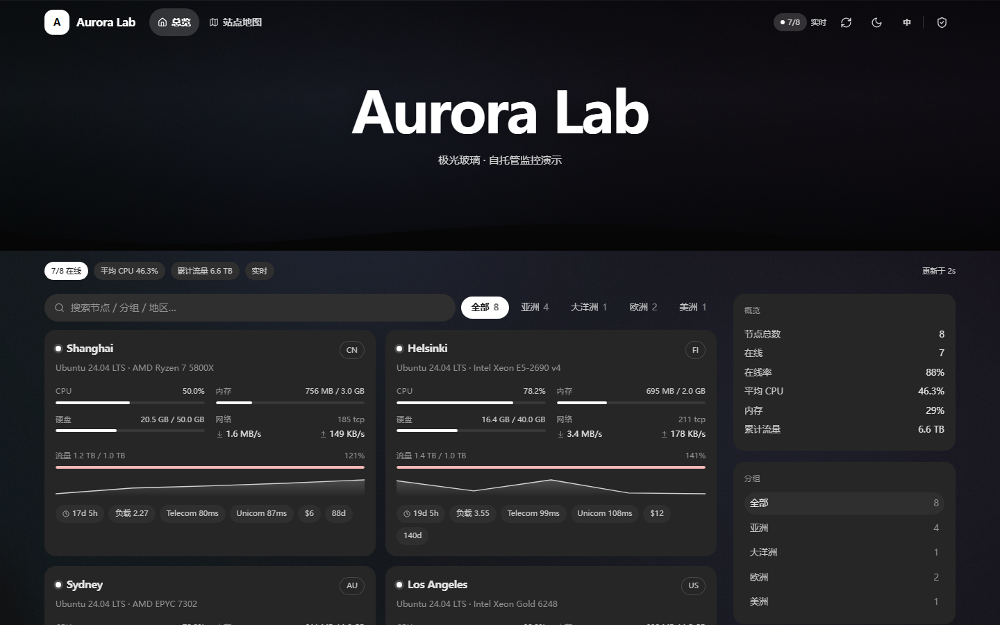

浅色（`/bg-light.jpg`）：

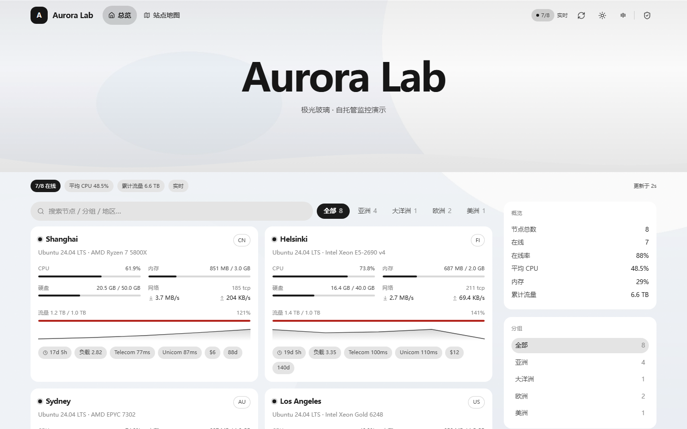

浅色主题会额外多叠一层 14% 白，深色主题不动——所以深色壁纸在浅色下也不会把字压没。
壁纸很花的时候把 `backgroundVeil` 调到 70~80，卡片是实色，不会透。

## 站点图标怎么换

左上角那块方形图标由两个设置决定，优先级从高到低：

| 设置 | 说明 |
| --- | --- |
| `logoUrl` | 图片地址。任意 URL 或 `/themes/Mono/dist/logo.png`，建议正方形 ≥72px，`object-cover` 裁切 |
| `logoText` | 没有图片时显示的字，最多 2 个字符（中文一个字最好看） |
| 站点名首字 | 上面都留空时自动取 `sitename` 的第一个字符 |

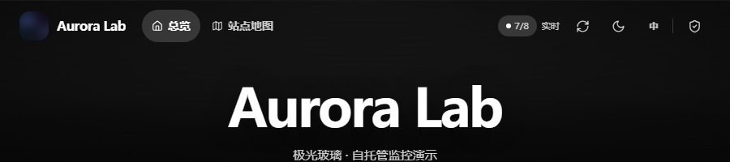

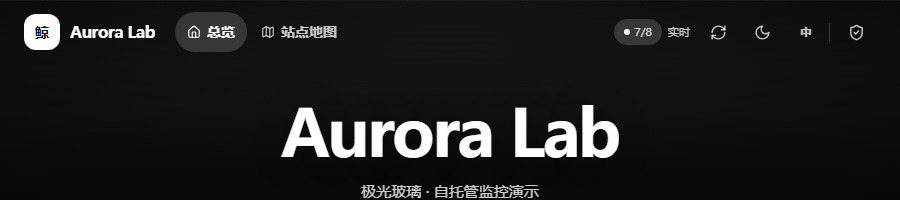

图片加载失败（404、跨域被拦）会自动退回字母块，不会显示破图标。

注意 Komari 的 `/api/public` 只给 `sitename`，没有站点 logo 字段，所以图标是主题自己的设置；
浏览器标签页的 favicon 仍由 Komari 后台控制，两者互不影响。

## 调色板（前台取色器）

1.7.0 起，**管理员**登录后前台右上角会多出一个调色板按钮（盾牌左边）。点开就是真正的取色器：

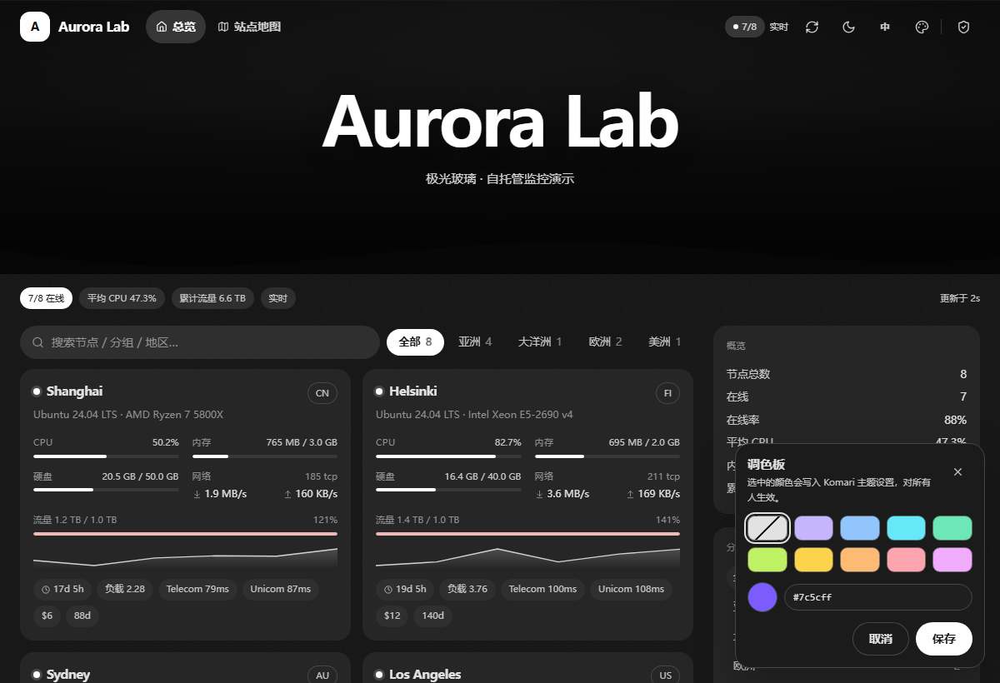

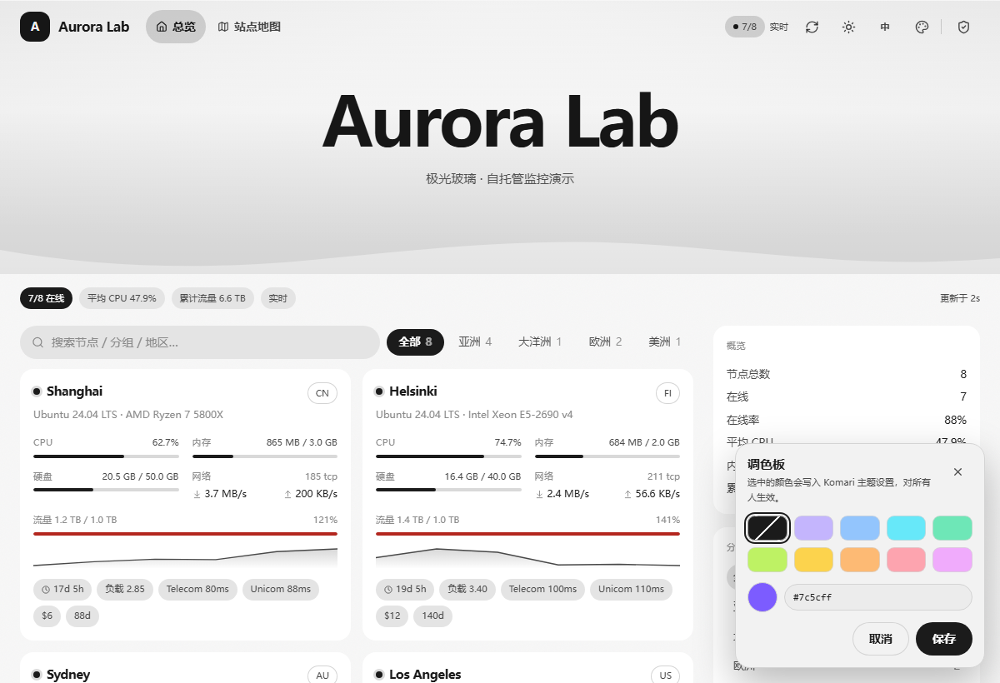

- 10 个预设色块 + 一个系统取色器（`<input type="color">`），旁边可以直接改 HEX
- 点「保存」立刻写回 Komari，**对所有访客生效**，不需要进后台、不需要手打色号
- 普通访客看不到这个按钮：主题启动时会向 `/api/admin/theme/list` 探一次，401 就不显示

实现方式：主题和面板同源，直接复用你的登录 cookie，调 Komari 自己的接口

```
POST /api/admin/theme/settings?theme=Mono   ← body 是整份 theme_settings
```

因为服务端是整份覆盖（`Assign(models.ThemeConfiguration{...})`），主题会先合并当前设置再提交，
不会把背景图、字体这些字段冲掉。

## 强调色怎么调

后台「强调色」是**下拉框**，11 个选项，选中项本身带中文说明：

```
纯黑白（跟随主题）(mono)   紫罗兰 (violet)   天蓝 (blue)
青色 (cyan)   薄荷绿 (emerald)   柠檬绿 (lime)   琥珀黄 (amber)
橙色 (orange)   玫瑰粉 (rose)   品红 (pink)   自定义颜色 (custom)
```

| 选什么 | 效果 |
| --- | --- |
| 纯黑白（默认） | 跟随深浅主题：深色下纯白、浅色下近黑，和参考站点一致 |
| 任一预设色 | 浅色块 + 深色字，用在在线点、进度条、图表线、选中 tab、标签上 |
| 自定义颜色 | 用下一行「自定义强调色」里填的 HEX，`#7c5cff` / `7c5cff` / `#abc` 都能识别 |

下拉框存的是整条文案（`紫罗兰 (violet)`），主题解析时会取括号里的代码，所以你手改成
`violet`、`#3366ff` 这种裸值也照样生效。认不出的值退回 `mono`，不会把页面弄坏。

自定义色会按亮度自动决定块上的文字用黑还是白（相对亮度 > 0.42 用黑字）：填深紫 `#4c1d95`
得到白字，填 `#fde68a` 得到黑字，不用自己配。

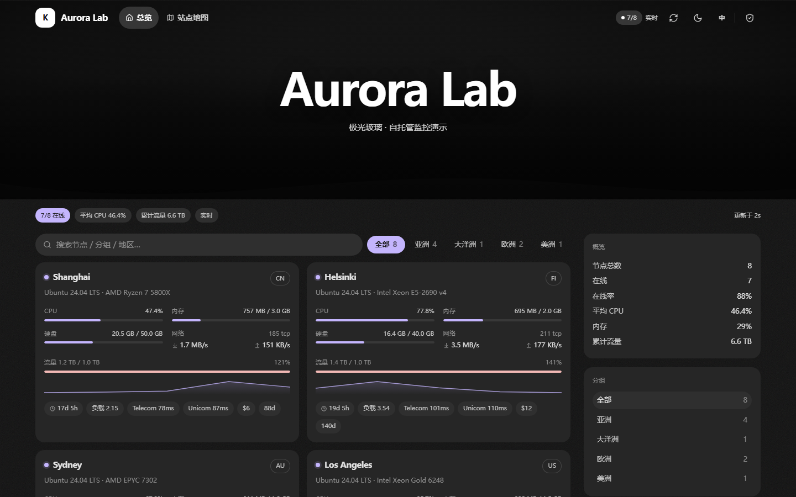

关于 `select` 的坑：Komari 后台用 `select` 时会执行 `(t.options || "").split(",")`，而它会把
主题清单缓存在库里——只要曾经存过一份 `options` 是数组的清单，后台主题页就永远崩
（`(t.options || "").split is not a function`），覆盖上传都不一定刷新。

所以这个下拉框的 `options` 一定是**逗号分隔的字符串**，不是 `[{label,value}]`：

```json
"type": "select",
"options": "纯黑白（跟随主题）(mono),紫罗兰 (violet),天蓝 (blue),着色…(custom)"
```

1.6.0～1.7.0 期间我把这几个字段全改成文本框以绕开缓存问题；**1.7.1 起强调色恢复下拉框**，
其余三个枚举（密度、背景排布、字体）仍是文本框。装完如果后台还崩，说明库里那份旧清单没换掉，
按 README 末尾「旧清单怎么清」一节处理。

## 字体怎么换

| 设置 | 默认 | 说明 |
| --- | --- | --- |
| `fontFamily` | system | 填 `system` / `sans` / `serif` / `mono` / `rounded` / `custom`，也可写中文标签 |
| `fontStack` | 空 | 选“自定义”时生效，填完整 `font-family` 值 |
| `fontSize` | 15 | 正文基准字号，12–20 |
| `fontUrl` | 空 | 返回 `@font-face` 的 CSS 地址，注入 `<link>`，可自托管 |
| `tabularNumbers` | true | 数字等宽，刷新不跳位 |

预设只声明字体栈，**不下载字体**，装没装取决于访客设备。要全站统一字形就配 `fontUrl`：
Google Fonts 的 CSS 地址可以，但国内网络建议自托管——把 woff2 和 `fonts.css` 放进主题
`dist/`，然后填 `/themes/Mono/dist/fonts.css`（打包时会被一起带进 zip）。

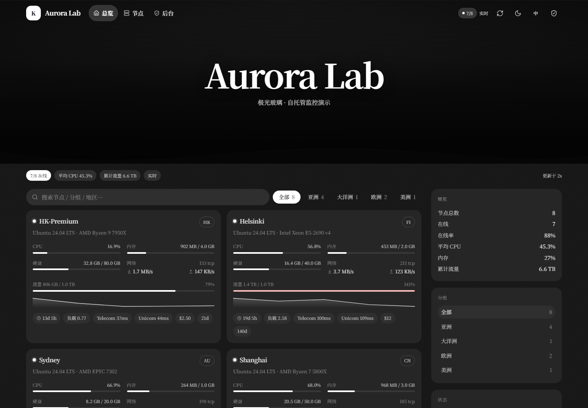

## 站点地图

导航栏第二项，或直接开 `/#sitemap`（hash 路由，刷新和分享都保持）。

| 能力 | 说明 |
| --- | --- |
| 两种分组 | 按分组 / 按地区，右上角切换 |
| 每行信息 | 状态点、地区 + 系统、CPU%、内存%、已用流量、在线时长 |
| 搜索 | 名称 / 分组 / 地区 / 系统 / 标签都能命中，无结果给空态 |
| 点行进详情 | 抽屉盖在地图上，关掉回 `#sitemap` 而不是总览 |

数据与总览页共用同一个 WebSocket 快照，不增加请求。

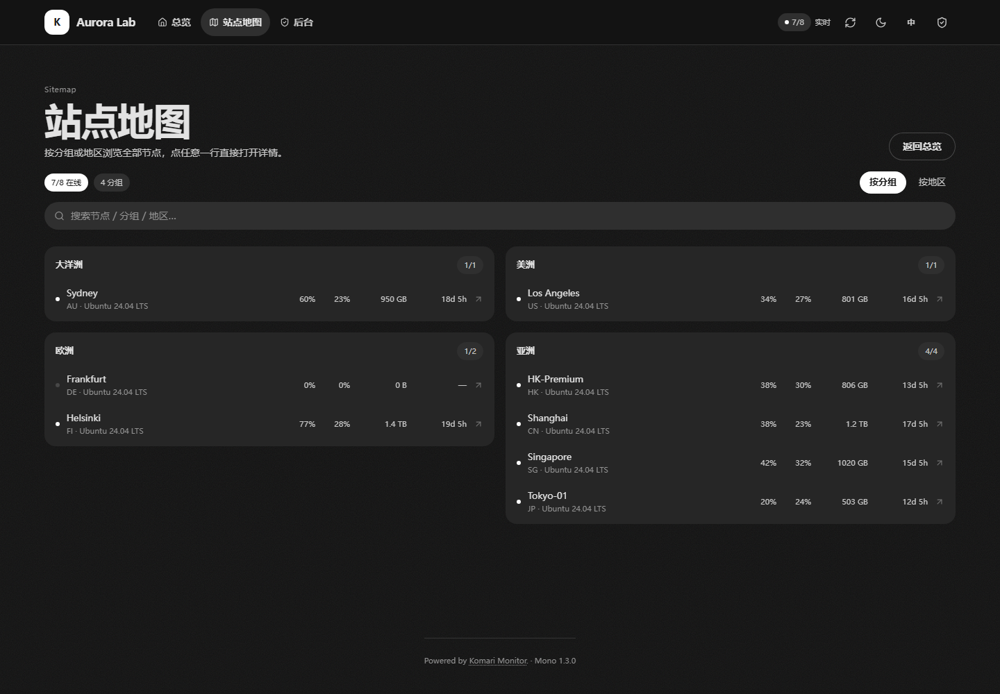

## 世界地图

站点地图页顶部，等距圆柱投影（equirectangular），只裁到 84°N ~ 58°S，南极不要。

| 项 | 做法 |
| --- | --- |
| 定位 | 先按节点名匹配城市别名（`Sydney` → 悉尼），再按 `region` 匹配 ISO 码 / 英文名 / 中文名（`HK`、`Hong Kong`、`香港`），最后按国家标注点 |
| 聚合 | 同一 0.5° 网格内的节点合成一个点，右上角显示数量 |
| 交互 | 悬停/聚焦出节点列表（最多 4 个 + `+N`），点击任一名字直接开详情；键盘 Tab + Enter 可用 |
| 配色 | 独立 token：`--map-sea` / `--map-land` / `--map-coast`，深浅色各一套，不跟卡片抢层级 |
| 开关 | 后台 `showMap`，关掉后地图整块不渲染 |

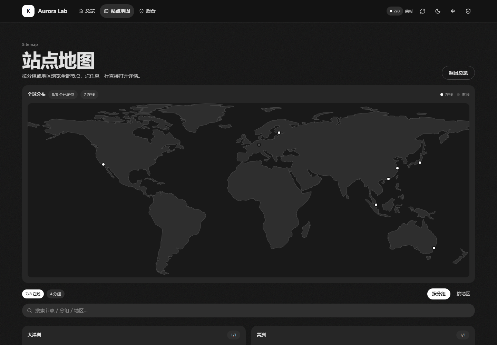

浅色：

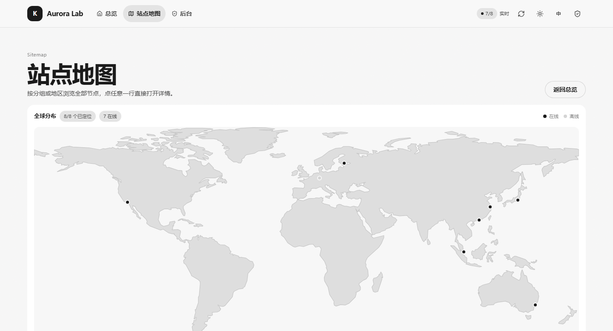

轮廓和坐标来自 **Natural Earth 1:110m**（公有领域），用 `tools/gen_map.py` 投影 + 道格拉斯-普克
简化后生成 `src/lib/geoData.ts`（约 34 KiB），打包进 JS，**运行时不发任何地图请求**。
改精度就改脚本里的 `TOLERANCE` / `MIN_AREA` 重跑，别手改生成文件。

`region` 写什么都能认一部分，但识别不了就落不了点（会提示）。写 ISO 码最稳。

## 安装

后台 → 主题 → 上传 `komari-theme-mono-1.7.1.zip` → 启用。banner 图在主题设置里填 URL，
不填就走内置深色渐变；整页背景图同理，留空即关闭。

## 几个坑

- `index.html` 会被服务端按字节替换 `<title>`、description、`</head>`、`</body>`，四个锚点必须原样保留，
  注释只能是纯 ASCII。
- 资源前缀写死在构建产物里（`/themes/Mono/dist/`），换 `short` 必须重新 build。
- 顶栏悬浮在 banner 上时靠 `style` 里覆盖 `--on-surface` 等变量换色；别再给子元素写死颜色。
- `backdrop-filter` 只用在顶栏滚动后的半透明底上，卡片保持纯色填充——参考站没有毛玻璃。
- 进度条颜色类挂在 `.track` 上，挂在 `<i>` 上会被内层覆盖。
- 背景层是 `position: fixed; z-index: 0`，正文 `main` 与页脚都得带上 `relative z-10`，否则会被盖住。
- 视图切换走 hash：`#sitemap` / `#node=`；两者互斥，关掉抽屉时按当前视图回写 hash，别让
  `replaceState` 把地图状态冲掉。
- `src/lib/geoData.ts` 是生成文件（`tools/gen_map.py`），改投影/精度只改脚本；`WORLD_PATH`
  是一条上千点的 `d`，别在编辑器里手改。
- 地图点位用百分比定位在 SVG 上方，所以容器必须保持 `aspect-ratio = 2000/789`，否则点和陆地会错位。
- hero 的底色/文字/遮罩走 `--hero-bg-image`、`--hero-fg`、`--hero-fg-muted`、`--hero-scrim`
  四组变量，深浅色各一套。填了 banner 图时 `<html>` 会加 `.has-banner`，把顶栏和标题强制改成白字——
  别再往标题上写死 `#fff`。
- **后台清单里不要出现 `select`**。Komari 渲染它时执行 `(t.options || "").split(",")`，而主题配置
  会被缓存进库——一旦存过一份 `options` 是数组的清单，后台主题页就永久崩，覆盖上传都未必刷新。
  1.6.0 起全部改成 `string` + 前端 `parseChoice()` 宽容解析（大小写、中文标签、括号代码都认）。
- 后台表单只认 5 种控件：`switch` / `select` / `number` / `richtext` / `string`。`nodes`、`pingtasks`
  这类多选控件在老版本里会退化成普通文本框，所以列表类设置一律用 `string` + 逗号分隔，前端自己 split。
- 枚举值写进 `description` 里告诉用户能填什么（`mono` / `violet` / `cover`…），因为没有下拉框了。

## 旧清单怎么清

后台主题页如果报 `(t.options || "").split is not a function`，多半是 Komari 库里存着**旧清单**
（`options` 是数组的那份），跟当前 zip 无关。先确认：

```
https://你的域名/themes/Mono/komari-theme.json
```

看 `"version"` 那一行：

- 是你刚装的版本 → 清单已更新，问题不在主题，去查别的主题
- 还是 `1.4.2` 这种旧号 → 文件没被替换，按下面走

1. 后台 → 主题 → **删除** Mono（不是禁用）
2. 重新上传 zip → 启用
3. 重启 Komari（`systemctl restart komari` / `docker restart komari`）
4. 后台页面 Ctrl+F5

还不行就手工覆盖：把 zip 里的 `komari-theme.json` 放到 `data/theme/Mono/komari-theme.json`，
再重启。这个页面是按主题逐个渲染表单的，**任何一个**主题的配置畸形都会拖垮整页，排查时可以先
只留一个主题。
